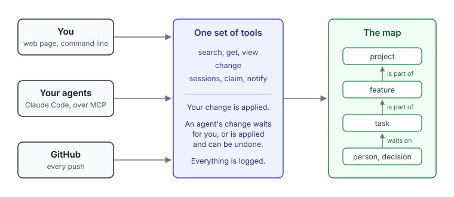

# Lattice

[](https://github.com/AlexReiner98/lattice/actions/workflows/tests.yml)

**A shared workspace for your people and your AI agents.**

If your business uses AI, where do the agents and the people work together?
Usually nowhere: each agent session starts from nothing, what it learned
stays in a chat, and nobody can say where a project stands without asking.

Lattice is that shared place, and the memory of your projects. It is a map of
the work: projects, tasks, decisions, people, and what waits on what. People
look at it in a web page. Agents read and change it through the same tools,
and what an agent changes either waits for a person's yes or is applied,
logged and one click to undo.

- **Your own kinds of thing.** A project type, a deliverable, a test result:
  types are files, and one type can be a flavour of another.
- **Dependencies that cannot go stale.** What blocks what is worked out each
  time from what depends on what, who is waited on and which resource is
  taken. Nobody maintains a status board.
- **Connected to where the work happens.** A push to GitHub is read against
  what was open; an agent's session registers itself, says what it takes on
  and leaves the map true when it ends.
- **A team, not one person.** Each member sees what is shared and what is
  their own, each agent acts for the person whose token it carries, and each
  customer's workspace is its own database.



## Start in five minutes

You need [Node.js](https://nodejs.org) 24 or newer. Nothing else: the database
is embedded and lives in a `data/` folder beside the code.

```bash
git clone https://github.com/AlexReiner98/lattice.git
cd lattice
npm install
npm start
```

Open `http://127.0.0.1:3100`. On the **Workspace** screen, type your name
under Owner: the map's questions ("what needs me?") are asked about you.

Then make something to look at. Press **New** on the Search screen and create
a project and a task in it, or let an agent do it in the next step.

## Connect Claude Code

In the folder of a project you work on with [Claude Code](https://claude.com/claude-code),
with the server running:

```bash
node -e "fetch('http://127.0.0.1:3100/connect/setup.mjs').then(r=>r.text()).then(t=>import('data:text/javascript,'+encodeURIComponent(t)))"
```

It writes a few files into that project and holds no secret: the connection
to the map (`.mcp.json`), hooks that register each session and count its
tokens, and working rules that it adds to the project's `CLAUDE.md`. It adds
to what is there and can be run again. On a server on your own machine no
token is needed, whatever its last line says. Quit Claude Code completely and
open it again in that folder.

## A first session

Open Claude Code in the connected project and ask it for something:

> Put this repository in Lattice as a project, with the three things I am
> working on as tasks, and tell me what you would do first.

What happens:

1. The session registers itself in the map. Work it has taken on is marked
   "session open".
2. The agent searches the map, then sends one change: the project, the
   tasks, and how they hang together.
3. The change waits for you. **Changes** shows each thing it would make; you
   apply it, leave parts out, or decline it. Nothing an agent sends takes
   effect before that, unless you choose otherwise in Workspace settings.
4. The next session in that folder starts by being told what is open there
   and what is blocked, and by whom.

From here the map answers the questions it is for: what needs you now, what
is blocked and on what, what changed since you last looked, what an agent
decided without you. A project's page draws its roadmap; an item's page
draws what it depends on.

## Where to go next

- **Use it from several machines, or with other people:** [Hosting](#hosting)
  and [Identity and workspaces](#identity-and-workspaces). Beyond your own
  machine the server asks for a token with every request.
- **Have the map follow your code:** [GitHub](#github-pushes-keep-the-map-current).
  A push is recorded, and an agent reads it against what was open.
- **Add your own kinds of thing:** [Packs and flavours](#packs-and-flavours).
- **Work on Lattice itself:** [CONTRIBUTING.md](CONTRIBUTING.md),
  [Dev mode](#dev-mode) and [Tests](#tests). Issues and changes from others
  are welcome.
- **Report a security problem:** in private, as [SECURITY.md](SECURITY.md)
  says.

Lattice is licensed under [Apache-2.0](LICENSE).

# Reference

## Running the server

`npm start` listens on `http://127.0.0.1:3100` and keeps its data in `data/`
(embedded Postgres, no install needed). Everything else talks to that server.
Only one server may use a data folder at a time: it writes `data.lock` beside
the folder, and a second one refuses to start.

### Dev mode

```bash
npm run dev
```

For working on Lattice itself, one person on one machine. It differs from
`npm start` in two ways:

- **Agent changes are not reviewed.** Every op applies at once unless
  `policy` in `lattice.config.json` says otherwise. Undo on the Changes screen
  still reverses a change set.
- **Agents can restart the server** with the `restart` tool, to run code they
  have just changed. The server is kept running by [src/dev.ts](src/dev.ts):
  if new code fails to start, it tries again when a file under `src/` or
  `packs/` changes. Its output is kept in `runs/dev-server.log`.

Approving, launching and tokens stay with you. Dev mode refuses to start with
`auth` set to `tokens`.

## Three surfaces, one set of tools

| Surface | Who | How |
|---|---|---|
| MCP at `/mcp` | Agents | A project's `.mcp.json` connects Claude Code: the setup command writes it (see Connect Claude Code above). |
| Web UI | You | Open `http://127.0.0.1:3100` while the server is running |
| CLI | You | `npm run lattice -- <command>` (run with no command for the list) |

All three call the tools in [src/tools.ts](src/tools.ts). The web UI and CLI
have human authority; the MCP endpoint does not, and two tools (`decide`,
`init`) are not offered to agents at all.

The web UI has three places, and one page for each thing.

- **Search** is where it opens. It finds anything in the map by words or
  type, and **New** makes a thing by hand.
- **Changes** holds what agents sent that waits for you: each part can be
  left out or corrected before you apply it. Below that it lists what agents
  changed without waiting since you last looked, each with Undo; "Mark all
  seen" records that you looked.
- **Workspace** holds the owner, agent tokens, members, GitHub, what agents
  may change unreviewed, importing a backup, and what the work has cost.

Every item has a single page, and every way to it leads there: its fields,
its note folded to the first paragraph, its relations drawn as a graph, and
its history. A project's page also draws its **roadmap** (its features in
the order they are to be built, with progress, and marked where a session is
open) and lists its open **questions**: decisions not made and hypotheses not
settled, the ones holding up the most first. A decision is made where it
stands: pick an option or type the outcome, and say why. The whole log of
changes is at `#/activity`.

The roadmap is the `tree` view, which agents can call too. The tree is
declared in the software pack (`trees` in
[packs/software/pack.json](packs/software/pack.json)): which types are roots,
branches and work, which field orders them, and which statuses mean "now". A
pack can declare another tree the same way, with no code.

**Following agents.** With "Follow agents" ticked (bottom of the menu), an
agent can bring your page to what it is working on: every change it makes
opens what it touched (or Changes, when the change waits there), and the `show`
tool opens any entity or screen with a one-line note. Anything you are in the
middle of is kept; the note offers the jump instead.

**Agents hear you.** What you do in the UI reaches the agents working with
you. An agent waiting in the `watch` tool is answered the moment you decide,
edit, approve or reject something, and the menu shows "An agent is listening"
while one waits. A Claude Code session in this repository is also told, with
your next message, what you did since it last heard (the `UserPromptSubmit`
hook the setup writes into `.claude/settings.json`).

The graph on an item's page shows its neighbourhood, one to four steps out:
what blocks what, what belongs to what, or every relation. A dashed red ring
marks what is blocked, and finished work is hollow. Drag to move, scroll to
zoom, click a node to open it. The UI is plain files in `ui/` with no build
step.

## How a change happens

Every change to the map goes through one tool, `change`: a list of ops
(`create`, `update`, `link`, `unlink`, `archive`, `restore`, `merge`,
`define_type`) with a
reason and a source.

1. The whole change is validated against the schema and the current map.
2. Policy decides: applied at once, or held as a proposal. Closing a decision
   or a hypothesis is held when an agent does it, whatever the server's policy
   (unless the workspace itself has chosen otherwise, below):
   the agent proposes the answer and you confirm it on the Changes
   screen. By default agents
   propose everything. Loosen it per op in `lattice.config.json`:
   `{ "policy": { "create": "auto", "link": "auto" } }`.
   A workspace can make the choice for itself, on its Workspace screen under
   Settings ("What agents change"): held until you have looked, or taking
   effect as agents make it, merges and archives included. Then an agent can
   settle a decision or a hypothesis too: a decision must say what was chosen
   and why, and you are notified on the Changes screen. The log and Undo are the record,
   not a gate. Its admin sets it; an agent cannot.
3. You look at what is held and apply or decline it, in the web UI's Changes
   screen or from the CLI (where the words are still approve and reject):

```bash
npm run lattice -- review
npm run lattice -- approve <id>
npm run lattice -- approve <id> --except some_ref,#12
npm run lattice -- reject <id> "why"
```

   A held change that asks only for what a later change has already made
   so (the task it would close is closed) leaves the queue as superseded,
   and the log says by which change.
4. Every applied op is written to the event log with who proposed it, who
   approved it, why, and the source, and on whose authority it was made:
   the human's own (their change, or a held one they applied), a human's
   word as an agent reports it (the agent must say what was said and where,
   and the log keeps that it is the agent's report), or the agent's own
   judgment (the default when it says nothing). An agent settling a decision
   or a hypothesis has to say which.

**Undo.** Any change set can be reversed, from its line in Activity or with
the `undo` tool. The opposite is applied as a new change, so the log keeps
both: created entities are archived, edits put back, links removed or
restored, archived entities restored. An edit that has been changed again
since is left alone and reported. A merge cannot be undone automatically.

`claim` and `release` (taking an exclusive resource, such as the one live Rhino
session) take effect at once for agents too.

## Sessions and the live lane

An agent session registers itself in the map as a run, says what it is working
on, and is given any exclusive resource that work needs, or told who holds it.
When the session ends, everything it held is released. These writes take effect
at once; they are the session's own state, not facts about the world.

- **From an agent:** the `session_start`, `session_update` and `session_end`
  tools. An agent that finishes a session in a repository is first shown that
  repository's open work nobody has changed since the session began, and has
  to change each item, say it is still true, or say it cannot tell from where
  it is (the item is then left as it was, and the run says it was not
  checked); what waits on a person's answer is not asked about. A session
  closed without that (by the hook, or a crash) is recorded as not reconciled.
- **Automatically, from Claude Code:** the setup command (below) writes the
  hooks into a project's `.claude/settings.json`; by hand, merge
  [examples/claude-code-hooks.json](examples/claude-code-hooks.json), which
  calls a server on the same machine. Each session opened there then registers
  on start and closes on end, and starts with what the map knows about that
  repository: the open work nothing blocks, the blocked work and what it waits
  on, and whether each exclusive resource is free. The repository is matched
  by the address the checkout was cloned from (the `remote` on a
  `software.repo` entity), which is the same on every machine, and failing
  that by its `path`.
- **A project with nothing of Lattice's in it** is connected by one command,
  given under "Connect an agent" on the Workspace screen and run in the
  project's folder. It fetches `GET /connect/setup.mjs` from the server and
  runs it: that writes `.mcp.json`, the hook script and the four hooks that
  call it, the friction skill, and the working rules
  ([examples/working-rules.md](examples/working-rules.md)), which it reads
  into the project's `CLAUDE.md`. It adds to what is there, holds no secret,
  and can be run again.
- **From a script:** `POST /agent/<tool>` takes the same tools as plain JSON
  with agent authority.

- **Launched from the map:** an entity page's **Launch session** button (or
  the human-only `launch` tool) starts a headless Claude Code session in the
  task's repository with its brief as the prompt. You choose what it may do:
  *investigate only* (plan mode, the default) or *may edit files*. It is
  registered before it starts, so it takes the lane or the launch is refused.
  Its answer, turn count and cost are written to the run when it ends, and
  the full transcript is kept under `runs/`. Ending the run from the UI stops
  the process. This needs the `claude` CLI on the PATH.

A session's page has **End session**, which releases what it holds; one that
has not reported for 30 minutes raises a notification. An entity page has
**Copy session brief**: the task's context, blockers, needed resources and the
rules that govern them, as text to start a session with.

## Notifications and automations

- **Notifications:** an agent (`notify`), an automation or the system can leave
  you a message. Unread ones are on the Changes screen. A session that stops
  reporting raises one, saying what it still holds.
- **Automations:** a trigger and an action, stored as an entity.
  - Triggers: `every` N minutes, `daily` at a local time, or an `event` in the
    activity log (`proposal.create`, or a prefix such as `resource.*`).
  - Actions: `notify`, call `check_connections` or `import_audit`, or `launch`
    a headless session on a task.
  - An automation an agent proposes does nothing until you approve it. Every
    firing is logged with its result. Events caused by automations cannot
    trigger automations, and a launching automation waits for its last session
    to end before starting another.
  - Create and pause them from Search, as things of the type Automation.

## Views

The questions the map exists to answer. `npm run lattice -- view` lists them.

| View | Question |
|---|---|
| `needs_me` | What needs me now? |
| `blocked_on_me` | What am I holding up? |
| `waiting_on` | What am I waiting on, and from whom? |
| `changed_since` | What changed since I last looked? |
| `at_risk` | What is about to go wrong? |
| `blockers` | What is blocked, and what has to move first? |
| `available_now` | What can run right now, and who holds each resource? |
| `sessions` | Which agent sessions are open, on what, holding what? |
| `brief` | What does a session need to know to start on this task? |
| `repo_work` | What open work belongs to this repository? |
| `handoff` | Where does this repository's work stand for whoever picks it up? |

Blockers are never stored. They are derived each time from `depends_on`,
`waits_on` and `needs` relations, so they cannot go stale. `depends_on` is
other work that has to be closed first; `waits_on` is a person, company or
agent who has to answer or act (say what for in the relation's `props.for`,
and remove the link once they have); `needs` is a resource.

In a change, a title or note can name an item the same change makes: `{ref}`
becomes that item's id when the change is applied. An agent can ask for its
own change to wait for a human with `hold: true`, even where agents' changes
are applied as made.

A handoff is mostly read off the map, so it does not go stale between
sessions: the last push, what is open, and what has happened since the
handoff note was written (pushes, what was settled or opened, the sessions
that ended and what each said). The note (`software.handoff`) is the one part
an agent writes, and holds only what the map cannot know: what nobody has
seen working, what bites when working here, what to do next and why.

## Packs and flavours

Types live in files under `packs/`, one folder per pack:

- `core`: the native types (person, company, agent, goal, area, project, task,
  decision, issue, hypothesis, result, event, resource, procedure, file, idea,
  note) and relations.
- `sys`: the system's own primitives (source, connection, run).
- `software`: application, repo, feature, bug, release, pull request,
  environment, spec, handoff.
- `local`: created when you approve a `define_type` proposal.

A type can extend another. A `software.bug` is a flavour of `issue`: it inherits
the parent's fields and statuses, and anything that searches or views issues
sees bugs too. Types outside `core` are named `<pack>.<name>`.

## Not built yet

- Launching into the desktop app. Launched sessions are headless.
- Semantic search. Search matches words in any form in titles and notes, puts
  the best match first, and falls back to near-misses in titles when nothing
  matches; it does not match by meaning.
- A Postgres server instead of the embedded database. Each workspace is one
  embedded database on the server's disk (see Hosting below).
- Editing the same item from two imports at once: the later edit wins as a
  whole (see Backups).
- Single sign-on.

## Hosting

A hosted Lattice is one server running everything, with the embedded
database on a persistent disk, on Render ([render.yaml](render.yaml)). TLS ends
at the platform.

- `LATTICE_HOST=0.0.0.0` makes the server listen beyond this machine. It
  refuses to start that way without `LATTICE_AUTH=tokens`, and never in dev
  mode.
- `LATTICE_PUBLIC_HOST=lattice.example.com` names what it is reached by.
  Requests for any other host name are refused.
- `LATTICE_TRUSTED_PROXIES` names the proxies in front of the server whose
  word is taken for where a request came from: networks as CIDR, comma
  separated, or `cloudflare` (set in `render.yaml`, since Render is reached
  through Cloudflare). Private networks are always trusted. The caller is
  the last address in `x-forwarded-for` that is not a trusted proxy; what
  stands before it he could have written himself (`src/address.ts`).
- `PORT` is honoured when `LATTICE_PORT` is not set.
- Each workspace is its own database and costs about 200 MB of memory while
  open, on top of about 350 MB for the server. A workspace nobody has used for
  30 minutes (`LATTICE_IDLE_MINUTES`; 0 for never) is closed and opens again
  on the next request, in under half a second. So 2 GB holds roughly eight
  customers working at the same moment, and more than that in all. A workspace
  with an enabled automation or an open session stays open.
- A hosted server does not launch sessions: launching starts Claude Code in a
  repository on the server's own machine.
- What answers without a token is asked only so often (`src/limit.ts`): a
  product's public page and the setup script, 120 requests a minute from one
  address and 1,200 from all together; GitHub's deliveries, 300 a minute from
  one address. Beyond that the answer is 429 with `Retry-After`. The count
  for all together is what holds if the proxies are not named
  (`LATTICE_TRUSTED_PROXIES`) and a caller's address cannot be told.

## GitHub: pushes keep the map current

A push is the moment reality moved, whoever did the work. Two things act on
it.

**The GitHub App is the short way to connect.** One app serves the whole
server, and may only read (contents and metadata):

1. The server's owner creates it once: Workspace, GitHub, **Create the GitHub
   App**, in the default workspace. Lattice sends GitHub a manifest, GitHub
   asks for a name, and hands the server the app's id, key and signing secret
   (kept in `github-app.json` beside the workspaces; or given by hand as
   `LATTICE_GITHUB_APP_ID`, `_KEY`, `_SECRET` and `_SLUG`).
2. A workspace's admin presses **Connect GitHub** and chooses repositories on
   GitHub. Each one chosen is put in the map with its address, and the
   installation is tied to that workspace.
3. Every push to a chosen repository arrives at `/github/app/hook`, signed
   with the app's secret, and is taken in exactly as below. Nothing is set up
   in the repository itself.

**An agent on the server reads each push that arrives through the app.**
Once the workspace's admin has given it an Anthropic key (the GitHub card,
**Set Anthropic key**; kept on the server, never shown again), every push of
commits to a branch is read against the repository's open items by an agent
that runs on the Lattice server (`src/reader.ts`), and every hour it asks
whether a re-check of old items is due. It has no checkout: it reads commits,
diffs, files and history through the app, which may only read. It does what
the workflow below does, sends its changes as any agent does (held or applied
as the workspace says), stops at 40 turns or 600k tokens, and records each run
in the repository with what it used. The model is `claude-sonnet-5-5`
(`LATTICE_READER_MODEL` changes it). Without a key, pushes are recorded and
not read. A repository connected both ways hears each push once.

**Or the server hears the push through a webhook added by hand.** On the Workspace screen, **GitHub** makes a
secret and shows the address to give GitHub (`/github/<workspace>`): in each
repository, Settings, Webhooks, Add webhook, content type `application/json`,
that secret, push events only. A repository is matched to the one in the map
whose `remote` is its GitHub address. From then on:

- every push, on any branch, is recorded against the repository in the
  activity log, and `repo_work` and the GitHub card say when it was last
  pushed to;
- on the default branch, a commit message that says what it finished
  (`closes e_abc12345`, `fixes e_...`, `done: e_...`) closes that item the
  way an agent would: held for you to confirm unless policy lets it through.
  Decisions and hypotheses are left alone; a commit cannot say what was
  decided.

**An agent reads the push.** [examples/github/lattice.yml](examples/github/lattice.yml)
is a GitHub Actions workflow: on every push it runs Claude in the repository,
connected to the workspace with an agent token, to read the new commits
against the repository's open items and propose what they change. Copy it to
`.github/workflows/` and set, in the repository's settings:

- variable `LATTICE_URL`: the server's address, e.g. `https://lattice.example.com`;
- secret `LATTICE_AGENT_TOKEN`: an agent token ("Token only" on the Workspace
  screen);
- secret `ANTHROPIC_API_KEY`, or `CLAUDE_CODE_OAUTH_TOKEN` for a Claude
  subscription.

It does nothing until `LATTICE_URL` is set. Each push is billed as a Claude
run, stopped at 2 dollars. It installs the Claude Code CLI and runs that (the
`claude-code-action` wrapper does not take push events). What it sends is held
for you or takes effect at once, as the workspace is set, like any agent's
change, and says it rests on the agent's reading of the commits.

**An agent re-checks what has gone longest unconfirmed.** The same workflow
asks the server once a day whether a re-check is due. Each project living in
the repository says how often, in its `recheck days` field (weekly when not
set, 0 for never). When a project has waited that long and has open items
nobody has changed or confirmed in that time, Claude is given the oldest of
them and checks those the code can settle: it changes what is done or wrong, marks what it has seen to
be still true (an update that changes nothing), notifies you of what the
repository cannot tell it, and calls `rechecked`, which starts the wait again.
A day when nothing is due ends before Claude is installed and costs no run.
Run the workflow by hand from the Actions tab to have a re-check now,
whatever the interval.
The `oldest` view shows the same thing to anyone who asks: what has gone
longest without a change or a confirmation.

## Secrets

What the server knows and must not give up is of two kinds.

- **What it only has to recognise is kept as a hash:** every token, and the
  operator secret. Each is shown once, when it is made, and cannot be read
  back out of the server or a backup.
- **What it has to use is sealed** (AES-256-GCM, `src/secrets.ts`): a
  workspace's Anthropic key, the secret a GitHub webhook signs with, and the
  GitHub App's key and signing secret. The sealing key is
  `LATTICE_SECRETS_KEY` (32 bytes, base64) when that is set, and otherwise a
  file the server makes beside the workspaces (`secrets.key`). It is never in
  a database or a backup, so a backup file, or the copy of it sent off the
  server, gives up none of these. A backup restored on another server reads
  them as not set, and they are set again there.

**An agent's token is the secret that lives on other machines,** in the
environment of whoever runs the agent, where any program running as that
person can read it. Three things limit what a copied one is worth:

- **It ends.** "Connect an agent" makes a token that expires in 90 days
  unless told otherwise; the token's row says when.
- **It can be limited to some repositories.** Such a token reads the map as
  its person does and can change only what is those repositories': what
  lives in them and all that is part of that or about it (`src/scope.ts`).
  What it makes has to be tied into that work in the same change. It cannot
  archive, merge or re-link anything else, define a type, or speak for
  another repository. What it may call is a list: beyond the tools that
  only read, it reports results for that work's tests, takes a resource
  that work needs or that no work is said to need, and notifies about that work. Everything else (a backup,
  the owner's word on settled questions, a tool added later) is refused
  until it is named in the list. The agent that reads pushes on the server is held to
  the repository it is reading in the same way.
- **Its owner hears of a new place.** Each token keeps the networks it has
  been used from. Used from one it has not been, a warning goes to the
  owner; the first place a token is used is not news. This notices, it does
  not prevent.

No tool gives a sealed secret back, to a person or an agent: the Workspace
screen says only whether one is set. A key is typed into a field that does
not show it. The agent that reads pushes never has the key in what it reads,
and can only read repositories and change the map; what it reads in a
repository is someone else's text, though, so its changes are an agent's like
any other, and are held for review where the workspace holds agents' changes.

## Backups

Every 6 hours the server writes each workspace out as one file of plain rows,
`backups/<workspace>/<time>.json.gz`, and keeps the newest 28 (a week). It goes
by the newest file, so restarting neither skips a backup nor piles them up.
`"backup": false` in `lattice.config.json` turns it off, `"backup": { "dir",
"everyHours", "keep" }` changes it, and `LATTICE_BACKUP_DIR` moves it.

A backup holds everything in the workspace, private things and token hashes
included, so treat the files like the data. A copy of the `data/` folder is not
a backup: taken while the server runs, it may not open again.

To restore, with the server stopped, into a folder that does not exist yet:

```bash
node src/backup.ts restore backups/default/<file>.json.gz data-restored
```

Then put that folder in place of `data/`.

To bring a backup into a map that already exists, an admin of that workspace
uses **Import a backup** on the Workspace screen (or the `import_backup`
tool). It merges, matching by id, and can be repeated as often as wanted, in
either direction:

- What the file has and the map lacks is added. Nothing is deleted.
- An entity on both sides keeps whichever was edited later, as a whole. Two
  edits to different fields of the same entity do not combine: the later one
  wins.
- A relation ended on either side is ended; a proposal decided on either side
  is decided; the file's history is added to the activity log.
- Tokens and settings are not touched. Sessions still open where the file
  came from, and what they hold, are left out.
- A map from elsewhere has its own person for its owner. When that differs
  from this workspace's owner you are asked whether they are one person; on
  yes, the owner here becomes the person in the file, with their tokens and
  everything private to them, so later imports line up.
- You are shown what would change before anything does, and the server takes
  a backup first, which is the way back: an import cannot be undone from the
  activity log.

The backups sit on the same disk as the data. To send a copy of each one off
the server, set `LATTICE_BACKUP_UPLOAD_URL` and `LATTICE_BACKUP_UPLOAD_KEY`:
any address that takes a file by POST with a bearer key. For Supabase Storage
that is `https://<project>.supabase.co/storage/v1/object/<private bucket>` and
a key allowed to write to it. A copy that fails is reported in the server's
output and the backup itself still stands. Copies sent away are not pruned.

## Identity and workspaces

By default the server is for one person on one machine: there is one workspace,
and which endpoint you call decides whether you are the human or an agent.

Set `"auth": "tokens"` in `lattice.config.json` (or `LATTICE_AUTH=tokens`) to
change that:

- **Every request carries a token** (`Authorization: Bearer lat_...`). The
  token says which workspace it belongs to and whether it is a human's or an
  agent's. A human token can approve, launch and manage tokens; an agent token
  cannot, on any endpoint.
- **First start prints two secrets, once:** your human token for the default
  workspace, and the operator secret.
- **Tokens** are made with `token_create`, listed with `token_list` and
  revoked with `token_revoke` (human only). Only a hash is stored. A launched
  session gets its own agent token, valid for a day and revoked when it ends.
- **Several workspaces in one browser:** the UI remembers each workspace you
  sign in to and switches between them from the menu's bottom corner; the
  workspace's name is shown under "Lattice" and on the tab. Signing out
  forgets that one.
- **Connecting Claude Code:** done once per machine. On the Workspace
  screen, press **Connect an agent**. It makes an agent token and shows two
  commands that put the server's address and the token into the environment
  variables `LATTICE_URL` and `LATTICE_AGENT_TOKEN` (on Windows, `setx`).
  Run them, then quit Claude Code completely and open it again. Every project
  whose `.mcp.json` reads those variables is then connected as you; the one
  the setup writes does, and the same file works in any project:

  ```json
  {
    "mcpServers": {
      "lattice": {
        "type": "http",
        "url": "${LATTICE_URL:-http://127.0.0.1:3100}/mcp",
        "headers": { "Authorization": "Bearer ${LATTICE_AGENT_TOKEN:-none}" }
      }
    }
  }
  ```

  With the variables unset it falls back to a server on this machine.
  Printing `LATTICE_URL` (`echo $LATTICE_URL`; in PowerShell,
  `$env:LATTICE_URL`) says which server a session will use. `claude mcp get
  lattice` says it too, but prints the token in full with it: keep that out
  of an agent's session and off a shared screen. The connection is kept in the machine's environment
  on purpose: an entry added with `claude mcp add --scope local` lives in
  Claude Code's own settings file, and was lost once when a running session
  wrote that file back. The hooks in `.claude/settings.json` follow the
  same two variables: each runs `.claude/lattice-hook.mjs`, which passes the
  hook on to that server with the token, or to the server on this machine
  when the variables are not set. So a session registers, hears what the
  owner did and closes on the same map its tools write to.
- **Using a token:** paste it into the web UI's sign-in screen; set
  `LATTICE_TOKEN` for the CLI; for Claude Code by hand, add
  `"headers": { "Authorization": "Bearer ${LATTICE_AGENT_TOKEN}" }` to the
  `lattice` entry in `.mcp.json`, and the same header to each hook.
- **Workspaces: one database per customer.** Each workspace has its own
  database, its own locally defined types and its own automation runner.
  Nothing is shared, so there is no filter to get wrong. The operator creates
  one and receives its first human token, in the web UI (Workspace screen,
  **Installation**, with the operator secret) or with a request:

  ```bash
  curl -X POST http://127.0.0.1:3100/operator/workspaces -H "content-type: application/json" -H "Authorization: Bearer <operator secret>" -d '{"id":"acme","name":"Acme Architects"}'
  ```

  The operator secret can create and list workspaces, and issue a workspace a
  new owner token when its owner has lost theirs ("New owner token" on the
  same card); it cannot read any workspace's map.

  **A workspace from a backup file.** Choose a backup file on the same card
  before pressing Create (or send its bytes in base64 as `"backup"` in the
  request above) and the new workspace starts as the map in that file:
  everything in it, the types it defined for itself, and its owner, whose
  token is the one handed back. This is how a map moves from one server to
  another. Tokens from where it came from do not work in the new workspace
  and arrive revoked. If the file cannot be put in, no workspace is made.

  **If the operator secret is lost**, run this on the machine the server runs
  on (on Render, in the service's Shell), with the server running:

  ```bash
  node src/cli.ts operator-reset
  ```

  It prints a new secret once and the old one stops working. What it proves
  is that you can write on the server's disk, so it needs the same
  `LATTICE_DATA` and port settings as the server.

- **Several people in one workspace.** An admin adds people with
  `member_add`, which creates their person entity and their token. From then
  on:
  - New things are **private to their author** unless created or edited as
    shared. An admin can flip that default with `workspace_set`.
  - Private means hidden from other members everywhere: search, by id,
    relations, the graph, the activity log and every view. The database
    enforces it (row level security), so no query has to remember to filter.
  - Each person's views are their own: "needs me" is what needs *them*.
  - Anyone can make an **agent token that acts for themselves**. That agent
    sees what they see, its proposals go to them alone, and its notifications
    reach only them.
  - Only an admin can add members, make human tokens or tokens for others, and
    change workspace settings. The first token of a workspace is an admin's;
    running `init` with it ties it to a person.

  - **Nothing can depend on a private item from outside it.** A shared item
    cannot `depends_on` or `needs` a private one; a private item cannot be
    shared while it waits on private items, unless they are shared in the same
    change; and an item cannot be made private while other work depends on it
    (a dependent hidden from you is counted, not named). So a blocker is
    always visible to everyone it blocks.
  - **A held resource is held for everyone.** If someone's private session
    holds the live lane, others are refused it and told it is held by
    "someone's private session".

- **Notifications between workspaces.** A human can send another workspace a
  notification with `notify_workspace`. It arrives only if that workspace's
  admin has added the sender to the workspaces it accepts, and accepting is
  one-way.
- **The Workspace screen** manages all of this: your agent tokens, members,
  the default visibility and which workspaces to accept notifications from.

Limits, stated plainly: unless told otherwise the server listens on this
machine only, and it never speaks TLS itself: hosted, that ends at the
platform in front of it. And on a single machine an agent running as your OS user can read any
token you keep in a file or environment variable, so tokens are a real
boundary between machines and between customers, not between you and an agent
on your own laptop.

## Tests

```bash
npm test
npm run typecheck
```
