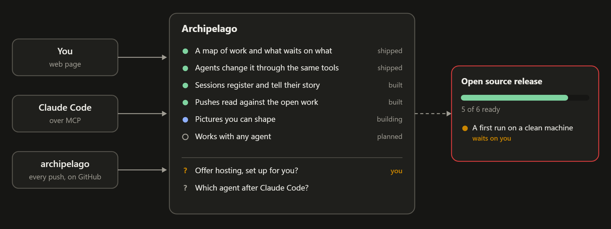

# Archipelago

[](https://github.com/AlexReiner98/archipelago/actions/workflows/tests.yml)

**A living map of all your work. From a chat to a structured model, so you and your agents are always on the same page.**

*Early: built and used daily by its author; expect rough edges.*

Each agent session usually starts from nothing, and what it learned stays in
a chat. Archipelago is the place the work lives instead: a map of projects,
tasks, decisions, people and what waits on what. You look at it in a web page;
agents read and change it through the same tools, over MCP. What an agent
changes is applied, logged and one click to undo, or waits for your yes if
you choose that.



## What you get

- **Home:** each project's open questions and its next release.
- **One page per item:** its fields, its note folded to the point, and a
  view of what it is tied to and what blocks it.
- **Changes:** what agents sent, to apply, trim or decline, and what they
  changed on their own, each with Undo.
- **Sessions that tell their story:** each agent session registers itself,
  says what it took on, and leaves the map true when it ends.
- **GitHub:** every push is read against the open work.
- **Time:** a calendar of your hours beside the agents' sessions, and
  invoices from it.
- **A log, not a table:** every change is one entry in an append-only,
  hash-chained log, and everything you see is read from it. Any item can be
  read as it was at any moment, and forgetting one takes its words out of the
  log and every backup with them.
- **Your own kinds of thing:** types and ways of working are plain files
  ("packs"), and one type can be a flavour of another. Which packs a
  workspace has is in its log too.

## Start in five minutes

You need [Node.js](https://nodejs.org) 24 or newer. The database is embedded.

```bash
git clone https://github.com/AlexReiner98/archipelago.git
cd archipelago
npm install
npm run demo
```

Open `http://127.0.0.1:3200`: a map of Archipelago itself, with a release
waiting on you, two open questions and an agent's proposal on **Changes**.
The screenshot above is its project page, drawn by a style of its own
([examples/demo/overview.js](examples/demo/overview.js)).

For your own map, `npm start` and open `http://127.0.0.1:3100`, go to
**Workspace** and type your name under Owner. The demo keeps its data apart,
in `demo/`.

## Connect Claude Code

In the folder of a project you work on, with the server running:

```bash
node -e "fetch('http://127.0.0.1:3100/connect/setup.mjs').then(r=>r.text()).then(t=>import('data:text/javascript,'+encodeURIComponent(t)))"
```

It shows the files it will write (`.mcp.json`, a few hooks, working rules in
`CLAUDE.md`) and asks first. Add ` -- --dry-run` to only see the list, or
` -- --remove` to take it out again. Then reopen Claude Code in that folder
and ask it something like:

> Put this repository in Archipelago as a project, with the three things I am
> working on as tasks, and tell me what you would do first.

Its change is on the map at once, and on **Changes** with Undo; under
**Workspace → Agents** you can have agents' changes wait for you instead.

## Host your own

One Node server with a persistent disk. Set `PELAGO_HOST=0.0.0.0`, `PELAGO_AUTH=tokens` and
`PELAGO_PUBLIC_HOST`; see [Hosting](docs/reference.md#hosting). For a team,
keep the maps on a Postgres server instead; `node src/cli.ts move` carries a
map between the two by replaying its log.

## More

- [Reference](docs/reference.md): every screen, tool, view, setting and
  limit.
- [Glossary](docs/glossary.md): the one word for each idea.
- [The log](docs/log.md): what is stored, and how everything else is read
  from it.
- [Packs](docs/packs.md): the fifteen keys of a pack file.
- [CONTRIBUTING.md](CONTRIBUTING.md) to work on Archipelago itself. It is
  published as it is, with no promise of answers or fixes.
- [SECURITY.md](SECURITY.md) to report a security problem in private.

Copyright 2026 Aperture Design Tools Inc. [MIT License](LICENSE).
