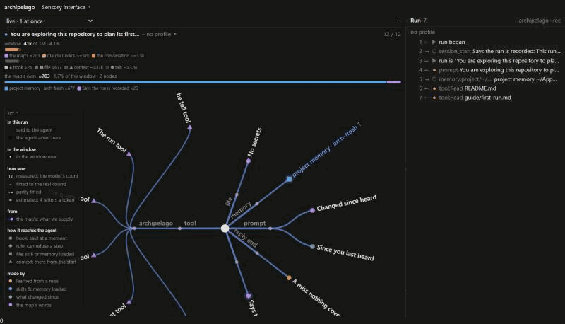
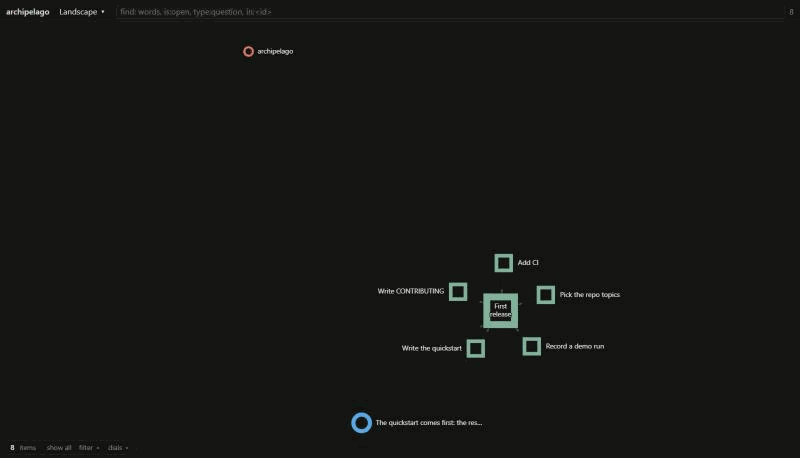
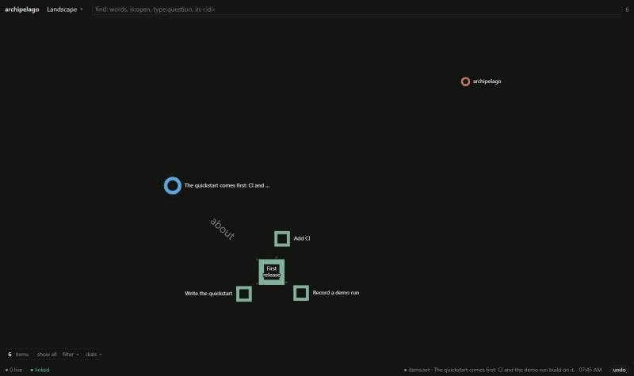

# Archipelago

**Sculpt the landscape around your agents.**

A map that sits beside Claude Code: it records what your agent is told and
what it does, and shows each run live, so you can shape what it plans,
remembers and learns. It runs on your own machine, with your data in one
ignored folder.

**The Sensory interface**: what Claude Code is told, where and by whom, live as
the run goes.



**The Landscape**: the map the agent works on, laying itself out as the agent
adds to it.



## What you need

- [Node.js](https://nodejs.org/) 22.18 or later (it runs the TypeScript
  directly and keeps the map in `node:sqlite`; no build step).
- [Claude Code](https://docs.claude.com/en/docs/claude-code), to connect an
  agent to it.

## Quickstart

```
git clone https://github.com/AlexReiner98/archipelago.git
cd archipelago
npm install
npm run serve
```

Open http://127.0.0.1:5280/app/ (or http://127.0.0.1:5280/, which sends
you there). The map is kept in `app/.data/`, which git ignores.

## Connect Claude Code

In the same folder, start a session that reports to your map, without
touching your own settings:

```
claude --settings packs/claude-code/settings.json --mcp-config packs/claude-code/mcp.json
```

Its hooks report each prompt, tool call and answer, and its MCP server gives
the agent the map's tools. Open **Sensory interface** to watch the run live.
To have every session report, a map with no run opens on **Field** with the
lines to copy into `~/.claude/settings.json`;
[First run](guide/first-run.md) has more.



## How it is built

- It gives each agent what it needs and the actions it can take, and records
  both, with everything the agent does.
- What works is kept. What doesn't is retired.
- Its types, rules, views and interface are packs, added and removed while
  it runs, without residue.
- Every part sits behind a versioned contract ([spec/](spec/README.md)) and
  can be replaced.

One process ([app/server.ts](app/server.ts)) runs the server's packs and the
page's dev server; the page's own packs are in [app/boot.ts](app/boot.ts).
The [guide](guide/README.md) walks through the concepts and how to write a
pack. To work on Archipelago while your own sessions report to it, see
[Live and dev](guide/live-and-dev.md).

## Status

Early. The first build is a live **harness view** for Claude Code sessions:
what is said to the agent, where it was said, by which pack, and whether it
worked.

## Contributing

See [CONTRIBUTING.md](CONTRIBUTING.md). Packs are code that runs with the
server's rights, so only load packs you trust; security reports go through
[SECURITY.md](SECURITY.md).

## Licence

MIT
